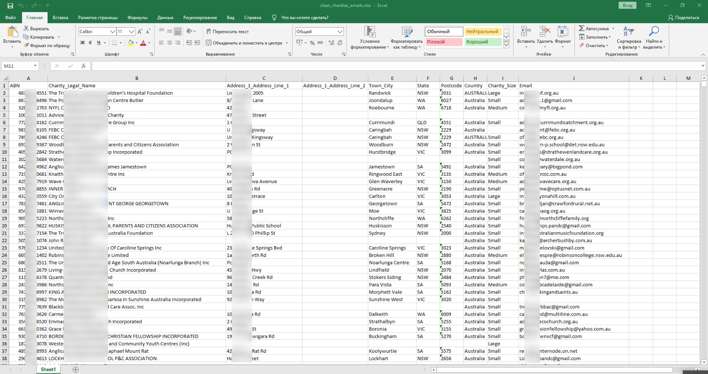

# ACNC 66K+ Charity Registry ETL & Direct API Pipeline

-green.svg)

A resilient, high-throughput asynchronous Python ETL pipeline engineered to extract, validate, and normalize **95,800+ charity records** directly from the Australian Charities and Not-for-profits Commission (ACNC) public Microsoft Dynamics API in **~5 hours** (slashing legacy 5–6 day browser scraping cycles), yielding **66,043+ active, verified organizational profiles** with direct contact emails and structured physical addresses.

---

## Key Architectural Highlights

* **High-Throughput Asynchronous Engine (`asyncio` & `curl_cffi`):** Leverages non-blocking asynchronous request pooling combined with browser-impersonated TLS handshakes (`chrome124`) and automatic HTTP/2 session rotation to handle rate-limiting reliably, extracting the entire 95k+ database in **~5 hours** (outperforming slow legacy headless browsers taking 5–6 days).
* **Fault-Tolerant Checkpointing (`progress.json` & `.jsonl`):** Streams raw JSON responses incrementally to disk (`acnc_results.jsonl`) with real-time state tracking, allowing seamless resumption from the exact point of interruption without data loss.
* **Strict Schema Normalization (`Pandas` & `OpenPyXL`):** Filters raw historical dumps (`95,828` total records) down to strictly active entities (`Status == Registered`, `66,043` rows), maps nested address schemas (`AddressLine1`, `AddressSuburb`, `AddressStateOrProvince`, `AddressPostalCode`), deduplicates entries, and exports client-ready `.xlsx` deliverables.

---

## Pipeline Architecture

<pre><code>[ACNC Dynamics API] 
        │
        ▼ (Async Browser-Impersonated Sessions via curl_cffi)
[pipeline.py] ──► Streams raw JSONL (acnc_results.jsonl) + Saves state (progress.json)
        │
        ▼ (Filtering: Status == 'Registered' & Schema Mapping)
[transform_to_tz.py] ──► Deduplicates & Normalizes via Pandas
        │
        ▼
[clean_charities_emails.xlsx] (66,043 Verified Records Ready for CRM/Outreach)</code></pre>

---

## Output Data Schema

The final `.xlsx` deliverable strictly adheres to enterprise B2B/CRM import specifications:

| Column | Source Field | Description |
| :--- | :--- | :--- |
| `ABN` | `Abn` | Validated Australian Business Number |
| `Charity_Legal_Name` | `Name` | Official registered entity name |
| `Address_1_Address_Line_1` | `AddressLine1` | Primary street / PO Box address |
| `Address_1_Address_Line_2` | `AddressLine2` | Secondary suite / building info |
| `Town_City` | `AddressSuburb` | Normalized suburb or city |
| `State` | `AddressStateOrProvince` | Australian state/territory code (`NSW`, `VIC`, `QLD`, etc.) |
| `Postcode` | `AddressPostalCode` | 4-digit postal code |
| `Country` | `AddressCountry` | Country identifier (`Australia`) |
| `Charity_Size` | `CharitySize` | Official ACNC tier (`Small`, `Medium`, `Large`) |
| `Email` | `Email` | Direct organizational contact email |

---

## Dataset Preview

---

## Quick Start

1. **Install dependencies:**
<pre><code>pip install -r requirements.txt</code></pre>

2. **Run extraction & transformation pipeline (with auto-resume):**
<pre><code>python pipeline.py
python transform_to_tz.py</code></pre>

