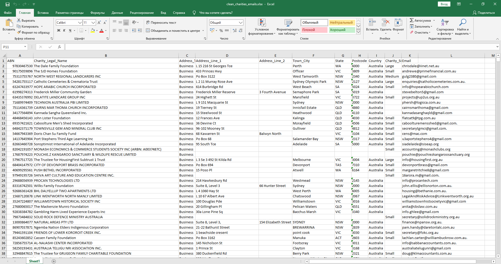

# 📊 ACNC 66K Lead ETL — Hybrid Data Enrichment Pipeline

> **High-performance Python ETL & Data Enrichment pipeline designed to enrich and clean 66,000+ Australian Charity (ACNC) records using Playwright Google SERP fallback, Human-in-the-Loop captcha handling, and Pandas validation.**

---

## 📌 Project Overview

Extracting contact details and verified decision-maker emails for 66,000+ registered charities from the official Australian Charities and Not-for-profits Commission (ACNC) dataset presents several engineering challenges: missing emails in public registries, strict search engine anti-bot rate limits, and massive dataset scale.

This project delivers an automated, fault-tolerant Python solution that enriches raw public registry records with verified email addresses discovered via Google SERP search, handles anti-bot rate-limiting gracefully, and exports clean, production-ready lead lists.

---

## 🏗️ Architecture & Pipeline Strategy

```text
┌─────────────────────────────────┐
│ Raw ACNC Registry Data          │ (66,000+ Records, data.gov.au)
└────────────────┬────────────────┘
                 │
                 ▼
┌─────────────────────────────────┐
│ Google SERP Enrichment Engine   │ (Playwright + Smart Pauses)
│  - Custom Manual Overrides      │
│  - Google SERP Extraction       │
│  - Human-in-the-Loop Captcha    │
└────────────────┬────────────────┘
                 │
                 ▼
┌─────────────────────────────────┐
│ State Persistence & Checkpoints │ (Auto-saves every 50 records)
└────────────────┬────────────────┘
                 │
                 ▼
┌─────────────────────────────────┐
│ Data Transformation & Cleanup   │ (Pandas ETL Workflow)
│  - Remove "Not found" / NaNs    │
│  - Filter Out Invalid Domains   │
└────────────────┬────────────────┘
                 │
                 ▼
┌─────────────────────────────────┐
│ Final Verified Lead Output      │ (Clean Excel File: 3,886+ Rows)
└─────────────────────────────────┘
```

---

## ✨ Key Technical Features

- **Google SERP Fallback Extractor:** Automatically queries Google Search (`acnc ABN: {abn} | {name} email`) via Playwright to discover off-site contact emails when official registry profiles lack direct contact info.
- **🛡️ Human-in-the-Loop Anti-Bot Resilience:** Built-in detection for Cloudflare / Google ReCAPTCHA rate limits. Pauses execution and alerts the operator to solve captchas manually without losing browser state or crashing the script.
- **⏱️ Long-Running Execution & State Persistence:** Designed for multi-day uninterrupted processing across 66,000+ rows with state checkpoints every 50 records to enable instant resume after power or network disconnects.
- **🧹 Intelligent Regex & Domain Filtering:** Filters out generic system domains (`google.com`, `schema.org`, `w3.org`, `example.com`) and extracts only valid, format-compliant email addresses.
- **📊 Pandas Lead Filtering:** Dedicated post-processing stage (`filter_clean_leads.py`) that eliminates incomplete records (missing ABNs, empty emails, or `"Not found"` tags) to yield high-quality leads.

---

## 🛠️ Tech Stack

- **Language:** Python 3.10+
- **Browser Automation:** Playwright (Chromium)
- **Data Engineering & ETL:** Pandas, OpenPyXL
- **Regular Expressions:** `re` module for email validation
- **Data Storage:** Excel (`.xlsx`) and Plain Text (`.txt`)

---

## 📁 Repository Structure

```text
acnc-66k-lead-etl-pipeline/
├── search_emails.py          # Google SERP extraction with state checkpoints & captcha pauses
├── filter_clean_leads.py     # Pandas script to filter valid ABNs and verified emails
├── extract_abns.py           # Helper utility to extract clean ABN lists from raw dataset
├── README.md                 # Project documentation
└── docs/
    └── dataset_preview.jpg   # Output snapshot preview
```

---

## 📊 Pipeline Output Preview

Below is a snapshot of the final processed dataset (`clean_charities_emails.xlsx`) containing verified ABNs, structured company details, and clean e-mail addresses:



---

## 🚀 Quick Start & Usage

### 1. Prerequisites
Ensure Python 3.10+ is installed along with required packages and Playwright browsers:

```bash
pip install pandas openpyxl playwright
playwright install chromium
```

### 2. Run Data Enrichment
Place your input file `datadotgov_main.xlsx` in the root directory and start the extraction pipeline:

```bash
python search_emails.py
```

*Note: If Google ReCAPTCHA appears during long runs, the script will log a prompt and pause to allow manual resolution in the headful browser before continuing.*

### 3. Run Post-Processing & Cleanup
Filter out non-matching rows and export the final lead dataset:

```bash
python filter_clean_leads.py
```

---

## 🛡️ License

Distributed under the MIT License. Feel free to adapt for commercial or research projects.
┌─────────────────────────────────┐
│ Final Verified Lead Output      │ (Clean Excel File: 3,886+ Rows)
└─────────────────────────────────┘
